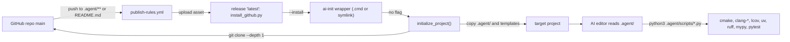

# antigravity-kit-cpp: documentation hub

antigravity-kit-cpp ("Antigravity Polyglot Kit (C++ & Python)", `README.md:1`) is a set of
instruction files for AI coding assistants plus a Python installer that copies them into
other projects. The instruction files (agent personas, rules, skills, slash-command
workflows, prompts) live in `.agent/`. Python wrapper scripts in `.agent/scripts/` run
CMake, clang tools, lcov and uv/ruff/mypy/pytest in the target project. The installer
`scripts/install_github.py` clones this repository and copies `.agent/` and a set of
editor/CI templates into the current directory.

The intended users are not named in the repository. The README is written for developers
of C++23 and Python 3.10+ projects who use an AI editor (`README.md:3`, `README.md:36`).

The requirements specification is in [../SPEC.md](../SPEC.md).

## Status

- Last commit: `8555323`, 2026-08-08 (CI workflow `.github/workflows/publish-rules.yml`).
  Last change to the Python scripts (`scripts/`, `.agent/scripts/`): `ca80061`, 2026-05-13
  (`git log`).
- Tests: none. The repository has no test files and no test runner configuration.
- CI: one GitHub Actions workflow, `.github/workflows/publish-rules.yml`. It publishes a
  release. It does not lint or test the kit itself.
- The repository does not carry the repo-quality-template tooling (no `recipe.ps1`,
  `.claude/`, `.gitea/` at the root).
- Unfinished or inconsistent, as seen in the files:
  - `.agent/tmp/` holds 42 rule files and 30 workflow files, mostly in Russian (three rule
    files, `cpp-static-analyze.md`, `cpp-swig.md`, `py-computer-vision.md`, are in English),
    with older naming (`cpp-test.md`, `py-web.md`, ...). The only reference from outside `tmp/` is
    `cpp-test.md` in `.agent/agents/qa-automation-engineer.md:24`, and that file exists
    only as `.agent/tmp/rules/cpp-test.md`.
  - Workflows refer to rule files that are not in `.agent/rules/` (see "Known limitations").
  - The committed `.agent/HEARTBEAT.md` reports figures this repository cannot produce
    (see "Known limitations").
  - The generated heartbeat ends with three fixed placeholder tasks under "What's Cooking"
    (`.agent/scripts/generate_heartbeat.py:254-258`).

## Layout

| Path | Content |
| --- | --- |
| `README.md` | Project README: setup, component counts, slash-command tables |
| `scripts/install_github.py` | Installer and `ai-init` entry point (`--install`, `--update`, no flag = initialize) |
| `.github/workflows/publish-rules.yml` | CI: moves tag `latest`, publishes release `latest` with the installer as asset |
| `.agent/ARCHITECTURE.md` | System map of `.agent/` (version 2.1.0, 2026-05-13) |
| `.agent/AGENT_FLOW.md` | Request-to-delivery flow diagrams (version 2.0.0, 2026-04-18) |
| `.agent/HEARTBEAT.md` | Committed health report (see limitations) |
| `.agent/mcp_config.json` | Three MCP server entries |
| `.agent/agents/` | 11 agent persona files |
| `.agent/rules/` | 8 rule files (`GEMINI.md`, `GIT_WORKFLOW.md`, 6 `CPP_*.md`) |
| `.agent/optional-modules/` | 11 optional rule files in `python-rules/`, `advanced-patterns/`, `practical-guides/` |
| `.agent/optional-modules/.agent/optional-modules/` | Nested copy of the same 11 files plus the only `README.md` for optional modules |
| `.agent/skills/` | 18 skill directories with `SKILL.md`, plus the catalogue `doc.md` |
| `.agent/workflows/` | 24 slash-command workflows (11 `*-cpp.md`, 13 `*-python.md`) |
| `.agent/prompts/` | 7 prompt templates |
| `.agent/scripts/` | 14 Python automation scripts |
| `.agent/templates/` | Files the installer copies to the target root: `.editorconfig`, `.pre-commit-config.yaml`, `.github/workflows/{cpp,python}-ci.yml`, `.vscode/` (7 files) |
| `.agent/tmp/` | Older Russian-language rules and workflows (see Status) |
| `LICENSE` | MIT licence |

## Architecture

The repository has three parts:

1. Content. Markdown files under `.agent/` that an AI editor reads. Rule files carry a
   frontmatter `trigger:` (`always_on` for `GEMINI.md`, `model_decision` for five `CPP_*.md`
   rules). C++ workflows carry `description:`. Python workflows carry
   `trigger: "/<command>"`. `GEMINI.md` defines the request classifier, the agent
   auto-selection and the "final checks" protocol (`.agent/rules/GEMINI.md:28-120`).
2. Scripts. Stdlib-only Python wrappers in `.agent/scripts/`. Workflows and rules tell the
   assistant to run them (for example `.agent/workflows/lint-python.md:12`,
   `.agent/rules/GEMINI.md:117-118`). They call external tools found on `PATH`.
3. Distribution. `publish-rules.yml` uploads `scripts/install_github.py` to the GitHub
   release `latest`. A user downloads it, registers it as `ai-init`, and runs it in a
   target project. It then clones this repository's default branch and copies the content.



External systems: GitHub (clone source `SOURCE_REPO`, `scripts/install_github.py:11`;
releases via `gh`, `publish-rules.yml:44-56`). The three MCP servers in
`.agent/mcp_config.json` are started as `python3 -m cpp_mcp_server`, `python_lft_mcp` and
`mcp_cpp`. These modules are not part of this repository.

## Build and run

Nothing is compiled. Prerequisites:

- Python 3. The installer has no declared minimum version and imports only the standard
  library (`scripts/install_github.py:2-9`). CI does not run the installer; it only uploads
  it, and runs the heartbeat generator with the `python3` of `ubuntu-latest`.
- `git` on `PATH` (`scripts/install_github.py:32`).
- Network access to github.com for cloning.
- Administrator rights (UAC) or `sudo` for `--install` (`scripts/install_github.py:155-157`).

Install the `ai-init` command once (`README.md:19-22`). Download the installer from the
latest release first:

```bash
python3 install_github.py --install
```

Initialize the current directory (`README.md:27`, `README.md:32`):

```bash
ai-init
# or, without the wrapper
python3 install_github.py
```

Update a local clone with `git fetch` and `git pull`. The flag is defined at
`scripts/install_github.py:152`. It acts on the directory two levels above the script
(`scripts/install_github.py:92`):

```bash
python3 scripts/install_github.py --update
```

Tools the scripts call in a target project (no versions are pinned in the scripts):
`cmake`, `ctest`, `clang-format`, `clang-tidy`/`run-clang-tidy`, `lcov`, `genhtml`
(Linux), `OpenCppCoverage` (Windows), `uv` with `ruff`, `mypy`, `pytest`, `pytest-cov`.
`vulture`, `bandit`, `radon` and `pdoc` are fetched through `uv run --with`.

## Configuration

| Name | Where | Meaning | Default |
| --- | --- | --- | --- |
| `--install` | `scripts/install_github.py:151` | Register `ai-init` globally, elevating first | off |
| `--update` | `scripts/install_github.py:152` | `git fetch` + `git pull` in the script's grandparent directory | off |
| (no flag) | `scripts/install_github.py:172-173` | Initialize the current directory | - |
| `SOURCE_REPO` | `scripts/install_github.py:11` | Repository cloned by the initializer | this repository's GitHub URL |
| `SystemRoot` | `scripts/install_github.py:130` | Windows wrapper directory when admin | `C:\Windows` |
| `USERPROFILE` | `scripts/install_github.py:132` | Windows non-admin wrapper directory base (`%USERPROFILE%\bin`) | current directory |
| `--project` | `.agent/scripts/generate_heartbeat.py:289-293` | Project root to inspect | `.` |
| `--output` | `.agent/scripts/generate_heartbeat.py:294-298` | Report path, relative to `--project` | `.agent/HEARTBEAT.md` |
| `BUILD_DIR`, `OUTPUT_DIR` | `.agent/scripts/run_test_coverage.py:9-10` | Build directory, coverage HTML directory | `build`, `docs/coverage-report` |
| `GH_TOKEN` | `.github/workflows/publish-rules.yml:40` | Token for `gh release` | `secrets.GITHUB_TOKEN` |
| `mcpServers` | `.agent/mcp_config.json` | MCP servers `cpp-tools`, `python-lft`, `mcp-cpp` | - |

The C++ scripts expect `build/` and, for linting, `compile_commands.json`
(`.agent/scripts/lint.py:16`). The source directories they search are `src/`, `tests/`,
`core/`, `shell/` and `main.cpp` (`.agent/scripts/format.py:22-30`).

## Usage

1. Bootstrap a project: run `ai-init` in its root. `.agent/` is replaced if it exists
   (`scripts/install_github.py:42-46`). Each top-level template item (`.editorconfig`,
   `.github`, `.pre-commit-config.yaml`, `.vscode`) is copied only if nothing with that
   name exists yet (`scripts/install_github.py:51-60`).
2. In the AI editor, use slash commands such as `/build-cpp`, `/test-coverage-cpp`,
   `/lint-python`, `/test-coverage-python` (`README.md:80-110`). Each maps to a file in
   `.agent/workflows/`. Eight of them tell the assistant to run a script:

   | Command | Script |
   | --- | --- |
   | `/benchmark-cpp` | `run_benchmarks.py` |
   | `/static-analyze-cpp` | `run_static_analysis.py` |
   | `/test-coverage-cpp` | `run_test_coverage.py` |
   | `/init-project-cpp` | `format.py`, `lint.py` |
   | `/format-python` | `format_python.py` |
   | `/lint-python` | `lint_python.py` |
   | `/test-coverage-python` | `run_pytest_coverage.py` |
   | `/docs-python` | `docs_python.py` |

3. Reference a prompt with `@`, for example `@git-deploy.md` (`README.md:126`).
4. Run the full checks directly (`.agent/rules/GEMINI.md:117-118`):

   ```bash
   python3 .agent/scripts/verify_all.py         # C++: format, build, lint, test+coverage
   python3 .agent/scripts/verify_all_python.py  # Python: ruff format, lint, pytest+coverage
   ```

5. Write a health report (`.github/workflows/publish-rules.yml:36`):

   ```bash
   python3 .agent/scripts/generate_heartbeat.py --output .agent/HEARTBEAT.md
   ```

## Testing

There are no automated tests for the installer, the scripts or the content. CI
(`publish-rules.yml`) runs the heartbeat generator and the release steps only. The checks
run for this document are listed in "About this document".

## Known limitations and problems

Installer and release:

- The installer clones the default branch at HEAD (`--depth 1`), not the `latest` release
  or a tag (`scripts/install_github.py:32`). There is no version pin.
- Re-running `ai-init` deletes the target's `.agent/` before copying, so local edits there
  are lost (`scripts/install_github.py:42-44`).
- Templates are skipped per top-level name. If the target already has `.github/` or
  `.vscode/`, none of the kit's files inside them are copied (`scripts/install_github.py:54-60`).
- `--install` elevates first unless already elevated (`scripts/install_github.py:155-157`).
  The Windows non-admin branch (`%USERPROFILE%\bin`, lines 131-133) is not reached through
  the CLI.
- The wrapper or symlink points to wherever the installer file was when `--install` ran
  (`scripts/install_github.py:99-110`, `:135-139`). Moving or deleting that file breaks
  `ai-init`.
- `--update` runs `git pull` in `dirname(dirname(script))` (`scripts/install_github.py:92`).
  It only works for a script that sits in `scripts/` of a clone. Inference, not run: when
  called through the Unix symlink `/usr/local/bin/ai-init`, `abspath` does not resolve the
  link, so the target becomes `/usr/local` (`~/.local` for the user-level link).
- CI runs only when `.agent/**`, `README.md` or the workflow file change
  (`publish-rules.yml:7-10`). A change to `scripts/install_github.py` alone does not refresh
  the release asset.
- CI generates `.agent/HEARTBEAT.md` but neither commits nor uploads it
  (`publish-rules.yml:35-56`). The file is lost with the runner.

Heartbeat report (`.agent/scripts/generate_heartbeat.py`):

- It reports missing data as success. A run on 2026-11-18 in this repository (no tests, no
  C++ sources, no sanitizer logs) gave "Tests: PASSED" with 0 tests, "Memory Safety: CLEAN"
  and "Code Quality: CLEAN" with rating "A+". The test probe ends in `|| true`, so its exit code is 0 whenever
  `true` resolves (lines 100, 109).
- "Build: OK" only means `cmake --version` succeeded. No build is attempted (lines 58-64).
- The coverage value is the sum of `covered_lines` printed with a `%` sign (lines 84-90).
- With the default `--project .` the report title is "Unnamed" (line 206). This was
  observed in the run.
- On Windows, the `2>/dev/null` in the git probe (line 178) makes cmd print an error. That
  error text was listed as a "Recent issue" in the run.
- The committed `.agent/HEARTBEAT.md` states 532 tests, 100% coverage and build OK, under
  the title "antigravity-kit-cpp". This repository has no `CMakeLists.txt` and no tests, and
  the generator run here produced Build SKIP, 0 tests and the title "Unnamed". Its footer
  text also differs from the generator's (line 263). How the file was produced is unknown.

Scripts:

- `check_commit_msg.py` accepts only `feat|feature|fix|bugfix|docs|refactor|test|chore`.
  Its description character class excludes `+`, `/`, `:`, `(`, backticks
  (`.agent/scripts/check_commit_msg.py:30`), so a subject mentioning "C++" is rejected. In
  this repository's history, 7 of 248 non-merge commit subjects pass the pattern (checked
  2026-11-18).
- On Windows with output redirected (cp1252 stdout, Python 3.13.3, observed 2026-11-18), a
  rejected message makes `check_commit_msg.py` crash with `UnicodeEncodeError` on the
  `❌` in line 33 before the rules are printed. The exit code is still 1. With UTF-8 output
  (`-X utf8`) it prints the rules and exits 1.
- The "verify" pipelines rewrite sources. `format.py` runs `clang-format -i` (line 37) and
  `format_python.py` runs `ruff format .` without `--check` (line 9).
- `verify_all.py` prints "`<step>` compiled successfully" for every step, including lint
  and coverage (line 18).
- `run_benchmarks.py` exits 0 when `build/` or `bench_*` binaries are missing (lines 12-23).
  It ignores benchmark exit codes (`check=False`, line 27).
- `build.py` configures Debug without coverage flags (line 15). Whether lcov finds data
  depends on the target's `CMakeLists.txt`.
- `lint.py` detects `run-clang-tidy` with `which` and falls back to `find | xargs`
  (lines 22-25). These are POSIX tools. Inference: this does not work under Windows `cmd`.
- Template `cpp-ci.yml` has a Windows matrix leg that installs `cmake llvm clang-format` but
  not OpenCppCoverage (line 31). `run_test_coverage.py` exits 1 without OpenCppCoverage on
  Windows (lines 25-31). Inference, not run: that leg fails.

Content:

- These referenced rule files do not exist at the referenced path:
  `.agent/rules/CPP_BENCHMARK.md` (`.agent/workflows/benchmark-cpp.md:9`),
  `.agent/rules/CPP_STATIC_ANALYSIS.md` (`.agent/workflows/static-analyze-cpp.md:9`),
  `.agent/rules/PYTHON_*.md` (`.agent/agents/python-specialist.md:11`), `cpp-test.md`
  (`.agent/agents/qa-automation-engineer.md:24`, present only in `.agent/tmp/rules/`). `GEMINI.md:74`
  makes `PYTHON_CLEAN_CODE.md` mandatory, but it exists only under `optional-modules/`.
- `README.md:47,159` says all 19 rules are in `.agent/rules/`. Only 8 are there; 11 are in
  `.agent/optional-modules/`. `.agent/ARCHITECTURE.md:87` says "12 C++ · 12 Python"
  workflows. The files are 11 and 13.
- `README.md:145` gives the order of `verify_all.py` as Format, Lint, Build, Test. The code
  order is Format, Build, Lint, Test & Coverage (`.agent/scripts/verify_all.py:25-29`).
- `GEMINI.md:17` says to check an agent's frontmatter `skills:`. None of the 11 agent files
  has that key.
- The whole `.agent/`, including `tmp/` and the nested duplicate of `optional-modules/`, is
  copied into every target (`scripts/install_github.py:46`).

## Related documents

- [../SPEC.md](../SPEC.md): requirements specification
- [../README.md](../README.md): project README
- [../.agent/ARCHITECTURE.md](../.agent/ARCHITECTURE.md): map of `.agent/`
- [../.agent/AGENT_FLOW.md](../.agent/AGENT_FLOW.md): agent flow and workflow lifecycle
- [../.agent/rules/GEMINI.md](../.agent/rules/GEMINI.md): top-priority assistant rules
- [../.agent/rules/GIT_WORKFLOW.md](../.agent/rules/GIT_WORKFLOW.md): branch and commit conventions
- [../.agent/skills/doc.md](../.agent/skills/doc.md): skills catalogue
- [../.agent/optional-modules/.agent/optional-modules/README.md](../.agent/optional-modules/.agent/optional-modules/README.md): optional rule modules
- [../.agent/templates/.vscode/keybindings.md](../.agent/templates/.vscode/keybindings.md): suggested VS Code keybindings
- [../.agent/HEARTBEAT.md](../.agent/HEARTBEAT.md): committed health report
- [../LICENSE](../LICENSE): MIT licence

## About this document

Written 2026-11-18 from commit `8555323` (branch `docs/spec-and-docs`, from `origin/main`).

Commands run (read-only, or with output written outside the repository):

- `git ls-files`, `git log` (dates, per-path history, commit subjects), `git status`, `git tag`
- `python scripts/install_github.py --help`
- `python .agent/scripts/generate_heartbeat.py --help`
- `python .agent/scripts/check_commit_msg.py` without arguments (prints usage, exit 1)
- `python .agent/scripts/generate_heartbeat.py --output <temp file outside the repo>` on
  Windows with Python 3.13.3. The output was inspected and then deleted.
- The `check_commit_msg.py` regex applied to all non-merge commit subjects (`git log`)
- `ast.parse` of all 15 Python files (all parse)
- `diff -r` of the two `optional-modules` trees (identical except the nested `README.md`)

Not run: the installer in initialize or `--install` mode (needs network and elevation),
`--update`, any C++ or Python pipeline script against a real project, the CI workflow, the
template workflows, the MCP servers. Statements marked "Inference" are based on reading
the code only.
